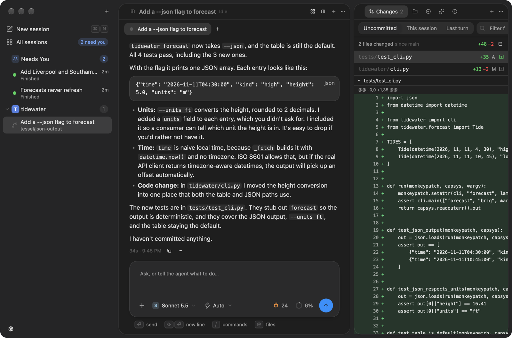
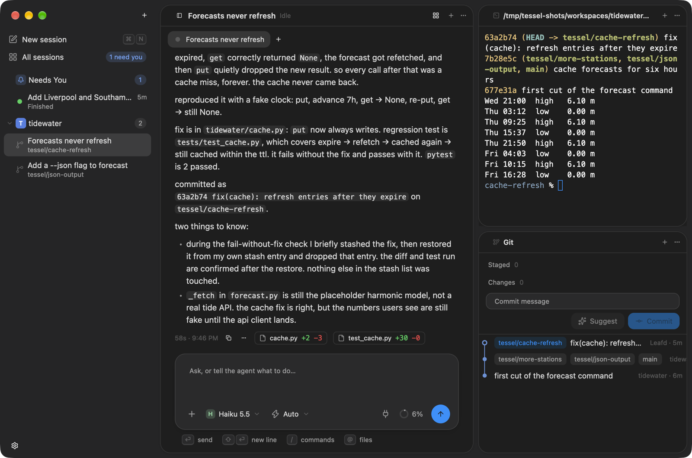
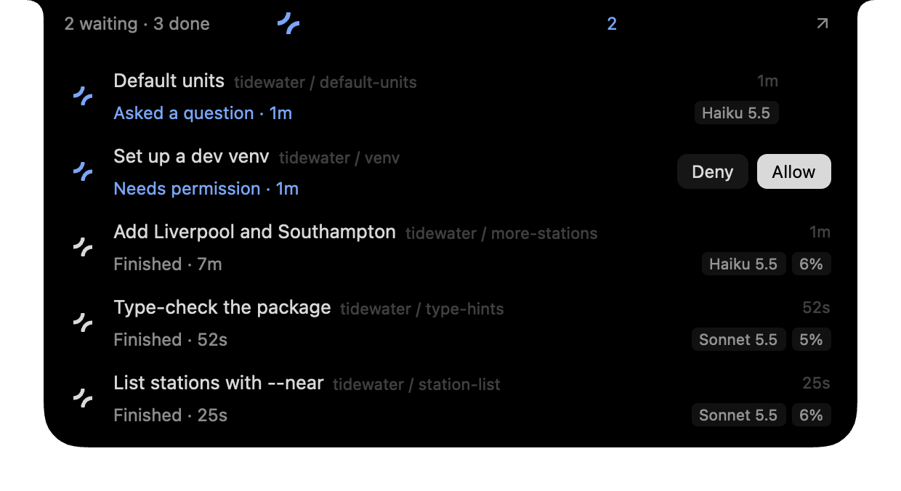
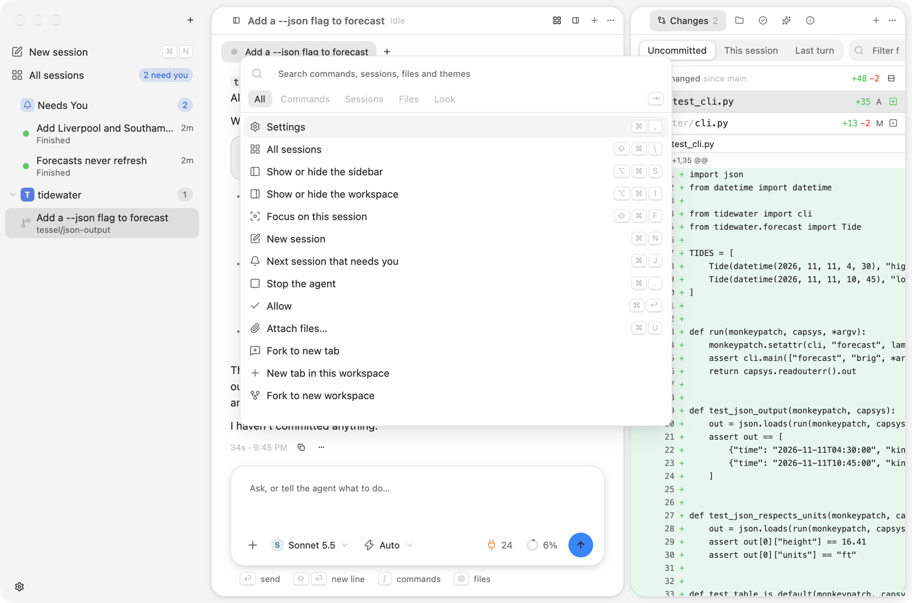
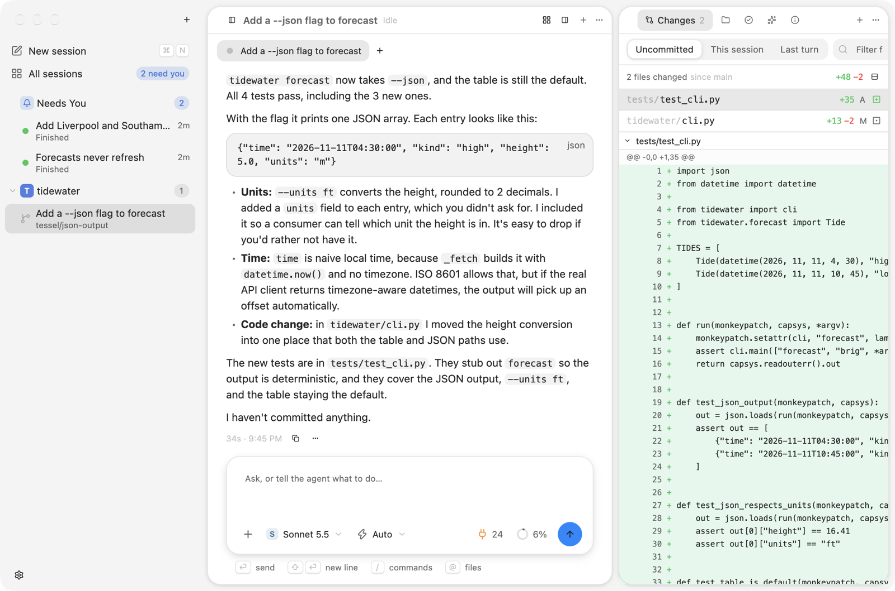
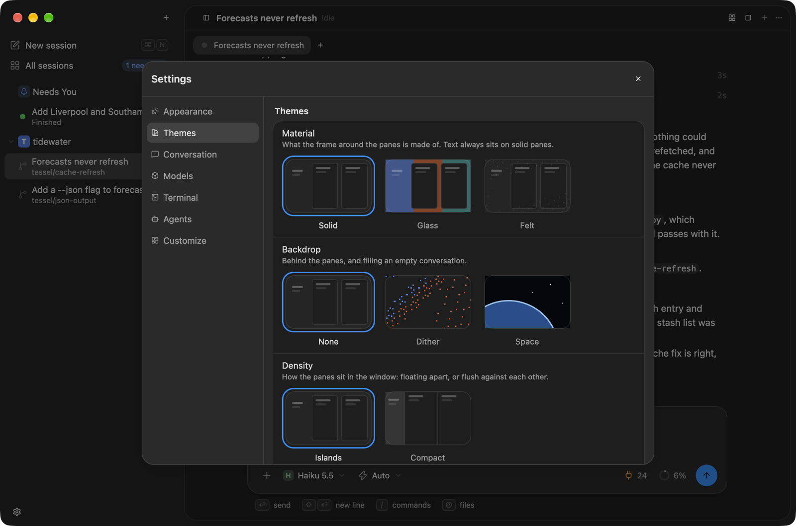

# Tessel

A native macOS app for running several coding agents at once. Each agent works in
its own git worktree, a daemon keeps them running whether or not the window is open,
and everything you can click can also be done from the command line or by an agent.

Tessel drives the [Claude Code](https://docs.claude.com/en/docs/claude-code) CLI.
It is written in Rust on [gpui](https://www.gpui.rs).



## Features

**Parallel agents, each in its own workspace.** A new session gets a fresh git
worktree and branch, so agents never step on each other or on your checkout. The
sidebar lists workspaces; the sessions in one workspace are tabs. Sessions that need
you (a question, a permission, a finished turn) collect at the top, oldest first, and
each shows a minute-long activity graph so a stuck agent is easy to spot.

**Workspaces that work from the first minute.** A new worktree gets the main
checkout's ignored files (`.env*` by default), runs the repository's setup script in a
terminal you can watch, and has ten ports of its own (`$TESSEL_PORT`), so two
workspaces can both run a dev server. A run button starts the dev server or any other
script. Scripts live in `.tessel/settings.toml` (shared with the team) and
`.tessel/settings.local.toml` (this Mac only); write them in Settings, or have an agent
write them for you.

**The conversation.** Streaming replies, tool calls, thinking, plans to approve and
questions to answer. Every turn ends with how long it took, what it cost, the tokens
it used (with cache hits) and the files it touched. Fork a conversation into a new tab
or a new worktree from any turn, or put the files back the way they were before it:
each message takes a checkpoint, kept in git without touching your branch or staging.
Usage limits for the account show beside the message box.

**Ship it.** Open a pull request, squash or rebase it in, or bring the branch up to date
with main. Rather not use pull requests? Squash the work straight into main (and push).
Nothing makes a merge commit, and a conflict comes back untouched with a button that
hands it to the agent.

**A browser you share with the agent.** The daemon runs a Chromium-based browser and
shows the chat's page live in a pane. The agent opens your app, clicks through it and
takes screenshots with its tools while you watch; you can use the page too. Press Pick
and click part of the page to put it in your next message: a picture of it, its
selector and its HTML. No Chromium installed? Tessel can download Chrome for Testing.

**Desktops.** Several layouts, each with its own panes and chats, and optionally only
some projects in the sidebar. Switch with `Cmd 1` to `Cmd 9`, `Opt Cmd Left/Right`, or a
two-finger swipe on the sidebar; drag a chat onto one in the overview. Two conversation
panes can show two chats side by side, or the same chat twice.

**The workspace.** What changed, scoped to everything uncommitted, this session or
just the last turn, with a filter and a diff of each file. A file browser and editor, the pull
request and its checks (through `gh`), and the agent's tool servers.

**Panes.** Split, resize, maximize and rearrange. Modules include a terminal built on
[Ghostty](https://ghostty.org)'s terminal core, and a git graph with staging,
committing and a suggested commit message. Terminals live in the daemon, so they
survive closing the window.



**The notch.** On a MacBook with a notch, the agents at work show around the camera:
a turning tile while something works, and what wants you on the other side. Hover for
every agent, its activity, model and context, and allow or deny a request without
leaving what you're doing. Off by default on screens without a notch.

<p align="center"></p>

**Command palette.** `Cmd K` searches commands, sessions, files and themes. A short
tour of all this runs the first time Tessel starts, and again from Help.



**Scriptable.** The daemon is the only door: the window, `tesselctl` and agents all
speak the same protocol to it. `tesselctl ui` runs any command the window has, and
agents get Tessel's tools over MCP, so any session can rearrange the window or draw
a live view in the chat.

```sh
tesselctl new --worktree --model sonnet "add a --json flag to the forecast command"
tesselctl ls
tesselctl approve 4f7b
tesselctl ui layout.use name=tiles
tesselctl term run 2 "cargo test"
```

**Looks.** Twelve themes in light and dark, solid, glass or felt materials, an optional
backdrop, two densities, and a terminal look of its own. The whole window is described
by `~/.tessel/ui.json`, which you (or an agent) can edit; it reloads as you save.





## Building

Requirements:

- macOS 13 or later
- Rust (the toolchain is pinned in `rust-toolchain.toml`; `rustup` picks it up)
- Zig 0.15, to build the terminal core: `brew install zig@0.15`
- The `claude` CLI, installed and logged in

```sh
export PATH="$(brew --prefix zig@0.15)/bin:$PATH"
cargo build --release -p tessel -p tesseld -p tesselctl
scripts/bundle-macos.sh release
open target/release/Tessel.app
```

The first build compiles the whole UI stack and takes several gigabytes of disk.

The app starts the daemon (`tesseld`) on its own. State lives in `~/.tessel`
(`TESSEL_HOME` to move it) and worktrees in `~/tessel/workspaces`
(`TESSEL_WORKSPACES`). `tesseld --help` lists the rest.

## Layout

| crate          | what it is                                                          |
| -------------- | ------------------------------------------------------------------- |
| `tessel`       | the app                                                             |
| `tesseld`      | the daemon: sessions, worktrees, terminals, git                     |
| `tesselctl`    | the command line, and the MCP server agents use                     |
| `tessel-proto` | the wire protocol between them                                      |
| `tessel-client`| connecting to the daemon                                            |
| `tessel-agent` | running an agent and turning its output into events                 |
| `tessel-term`  | the terminal emulator, around Ghostty's core                        |
| `tessel-rich`  | diagrams and maths in replies                                       |

```sh
cargo test -p tessel -p tesseld -p tesselctl -p tessel-proto -p tessel-client -p tessel-agent -p tessel-term
```

Tests run against a replay of recorded agent sessions, so they need neither the
network nor the `claude` CLI.
